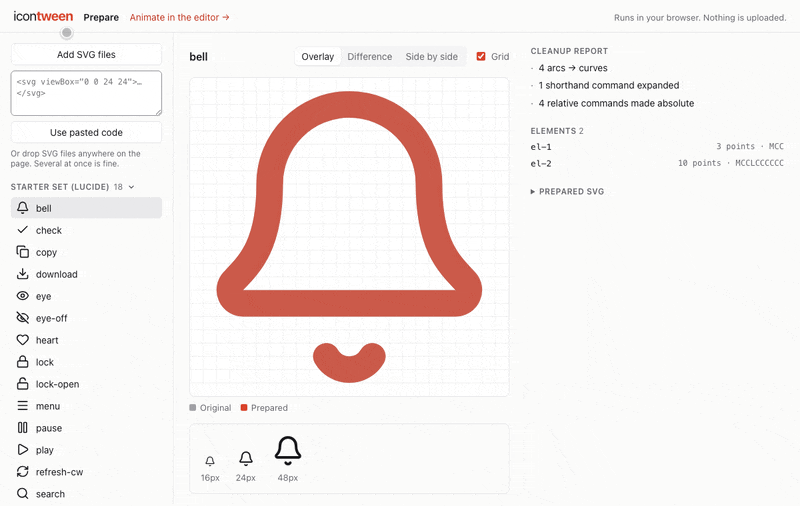
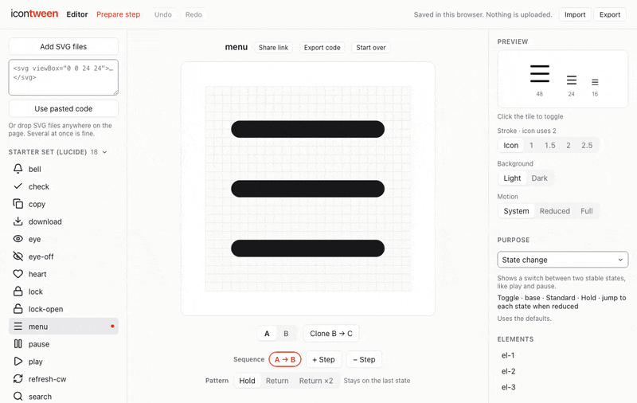
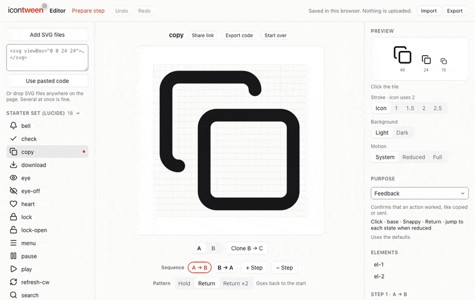

<h1 align="center">IconTween</h1>

<p align="center"><strong>Motion for the moments that matter.</strong></p>

<p align="center">
  
</p>

<p align="center">
  <a href="https://icontween.com"></a>
  <a href="https://github.com/vedjuk/icontween/actions/workflows/ci.yml"></a>
  <a href="LICENSE"></a>
  <a href="packages/runtime"></a>
  
</p>

<p align="center"><a href="https://icontween.com"><strong>Open IconTween →</strong></a></p>

Bring your own SVG icon and give it purposeful, state-based motion, from smart presets to every
last point. Then hand it off as small, readable code.

IconTween is for the few icons in a product that deserve a crafted moment: a copy button that
confirms, a menu that becomes a close, a bell that asks for attention. Everything runs in your
browser. Nothing you make is uploaded.

The animation above is IconTween's own SVG export: plain SMIL, no JavaScript, playing as an
image. It's rebuilt from the starters with `pnpm readme-hero`.

## How it works

1. **Drop in your icon.** Any SVG, from any icon set or your own. It stays in your browser, and
   IconTween works on a clean copy.
2. **Start from a purpose, or go manual.** Pick feedback, state change or another purpose, and
   the trigger, timing and reduced motion are set for you. Or shape every point, curve and step
   yourself.
3. **Export clean code.** SVG with SMIL, HTML, React or JSON. Small, readable, and it plays
   exactly like the preview.

<!-- GIF placeholders: docs/media/prepare.gif, docs/media/edit.gif. Uncomment once recorded.


-->

The landing page has twelve starters made from [Lucide](https://lucide.dev) icons. Each opens in
the editor so you can see how it's made.

## Export formats

Every format handles reduced motion (when the OS asks for less motion, the icon jumps, fades or
stays still, as you chose), and says what it does in a comment at the top.

| Format             | File           | Use it when                                                                                                       |
| ------------------ | -------------- | ----------------------------------------------------------------------------------------------------------------- |
| **SVG (no JS)**    | `copy.svg`     | You want one file with no script. SMIL animation; all triggers work inline, loop and appear also work as ``. |
| **HTML + runtime** | `copy.html`    | You want a complete page that works, even opened from disk. The runtime is inlined.                               |
| **React**          | `CopyIcon.tsx` | You're in a React app (18 or 19). Uses `icontween.js` + `icontween.d.ts`, downloaded once.                        |
| **JSON**           | `copy.json`    | You want to drive the animation yourself with the runtime.                                                        |

<!-- GIF placeholder: docs/media/export.gif. Uncomment once recorded.

-->

### React

Put the component next to `icontween.js` and `icontween.d.ts` ("Download runtime" in the Export
dialog). Place it inside a button so the whole button is the target:

```tsx
import { useRef } from 'react';
import { CopyIcon, type CopyIconHandle } from './icons/CopyIcon';

export function CopyButton() {
  const button = useRef<HTMLButtonElement>(null);
  const icon = useRef<CopyIconHandle>(null);

  return (
    <button ref={button} type="button" aria-label="Copy">
      <CopyIcon listenOn={button} ref={icon} size={24} />
    </button>
  );
}
```

Props: `size`, `trigger` (`'hover' | 'click' | 'toggle' | 'loop' | 'appear' | 'manual'`, or
`'none'` to bind nothing), `listenOn`, `reducedMotion` (`'auto'` follows the OS), plus any
`<svg>` prop. The ref has `play()`, `reverse()`, `toggle()`, `stop()` and `setState(id)`, typed
to the icon's state ids.

### Runtime

The runtime plays an animation on an inline `<svg>`. With the JSON export:

```html
<button type="button" id="copy-button" aria-label="Copy">
  <svg id="copy-icon" width="24" height="24"></svg>
</button>

<script type="module">
  import { createPlayer } from './icontween.js';

  const { animation } = await fetch('./copy.json').then((r) => r.json());

  const player = createPlayer(document.getElementById('copy-icon'), animation, {
    listenOn: document.getElementById('copy-button'),
  });
  // player.play(), player.reverse(), player.toggle(), player.setState('B'), player.destroy()
</script>
```

Paths are matched by `data-icontween-element`, and any that are missing are created, so an empty
`<svg>` works. Options: `trigger`, `listenOn`, `reducedMotion`, `tokens`, `onFinish`. Types are
in [`packages/runtime/types/icontween.d.ts`](packages/runtime/types/icontween.d.ts).

The runtime isn't on npm yet. Each export brings its own copy (decision
[016](docs/decisions/016-exports-runtime-react-json.md)).

## Quick start (contributors)

Requires **Node 24** (`.nvmrc`) and **pnpm 10**. From the repo root:

```bash
pnpm install
```

```bash
pnpm dev
```

| Command             | What it does                                                                                                                 |
| ------------------- | ---------------------------------------------------------------------------------------------------------------------------- |
| `pnpm dev`          | Editor and landing page on http://localhost:5173                                                                             |
| `pnpm test`         | Vitest in every package with tests (`pnpm --filter @icontween/core test` for one)                                            |
| `pnpm typecheck`    | `tsc` in every package                                                                                                       |
| `pnpm lint`         | ESLint and a Prettier check (`pnpm format` fixes formatting)                                                                 |
| `pnpm build`        | Production build, static output in `apps/web/dist`                                                                           |
| `pnpm export-check` | Builds every starter in every format and serves a self-checking page on http://localhost:5180 for Safari, Chrome and Firefox |

CI runs typecheck, lint, test and build on every push. Cloudflare builds `main` and serves
`apps/web/dist` at icontween.com as static files ([`wrangler.jsonc`](wrangler.jsonc), decision 022). Read [`CLAUDE.md`](CLAUDE.md) for the
rules and [`PROJECT_BRIEF.md`](PROJECT_BRIEF.md) for the full picture.

## Architecture

A pnpm monorepo. Workspace packages are used from source, with no build step between them
([001](docs/decisions/001-monorepo-and-tooling.md)).

```
apps/web           editor + landing page (Vite, React, TypeScript, Zustand)
packages/core      schema, validation, geometry, prepare pipeline, export generators (pure TS)
packages/runtime   the playback library that ships in every export, no dependencies
packages/react     React wrapper (placeholder: components are generated by the React export)
examples/          the starter project (starters.icontween.json)
docs/decisions/    one short note per decision
```

**One rule holds it together: every state has the same structure.** All states of an icon have
the same elements, in the same order, with the same path commands and point count. States only
change numbers, so any two states can be tweened point by point. `validateAnimation()` in core
enforces it.

**The prepare pipeline** turns any SVG into that shape, on a clone (the source is never changed):
parse with `DOMParser`, sanitize against an allowlist (no scripts, `foreignObject`, event handlers
or remote references), resolve inherited styles, convert shapes to paths, flatten transforms, and
normalize every path to absolute `M`, `L`, `C`, `Z` (arcs become cubics). A report says what
changed and, in plain words, what was left out (text, masks, gradients…). The editor shows the
original over the prepared copy so you can confirm they match. Structure changes, like adding a
point, happen only here, before state B exists
([003](docs/decisions/003-prepare-pipeline.md), [020](docs/decisions/020-library-import-and-editor-welcome.md)).

**Preview = export.** The editor and the landing page play animations with the same runtime
source that ships in the exports. The SVG + SMIL export can't use the runtime, so a test compares
the SMIL with the runtime at 61 points in time for every starter, and `pnpm export-check` does
the same in real browsers ([005](docs/decisions/005-runtime-v0.md),
[016](docs/decisions/016-exports-runtime-react-json.md),
[017](docs/decisions/017-svg-smil-export.md), [018](docs/decisions/018-cross-browser-export-check.md)).
Morphs never rely on CSS animation of `d`, which has had gaps in Safari.

**No backend.** Projects auto-save to IndexedDB, and move between machines as `.icontween.json`
files or share links that carry the animation in the URL hash
([014](docs/decisions/014-auto-save-and-project-files.md), [015](docs/decisions/015-share-links.md)).

All decisions are in [`docs/decisions/`](docs/decisions/), and progress in
[`docs/devlog.md`](docs/devlog.md).

## Licence

[MIT](LICENSE) for IconTween. The starter icons are derived from [Lucide](https://lucide.dev)
(ISC), see [`THIRD_PARTY_LICENSES.md`](THIRD_PARTY_LICENSES.md).
